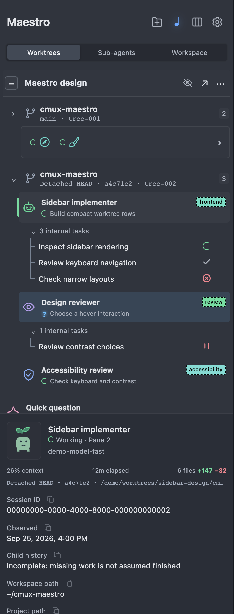
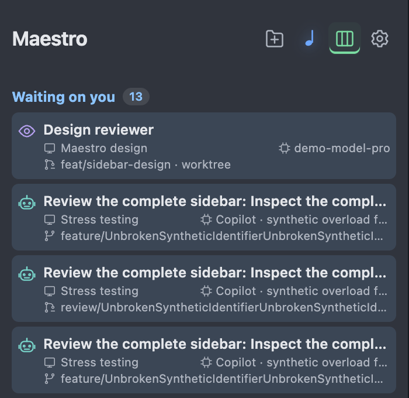
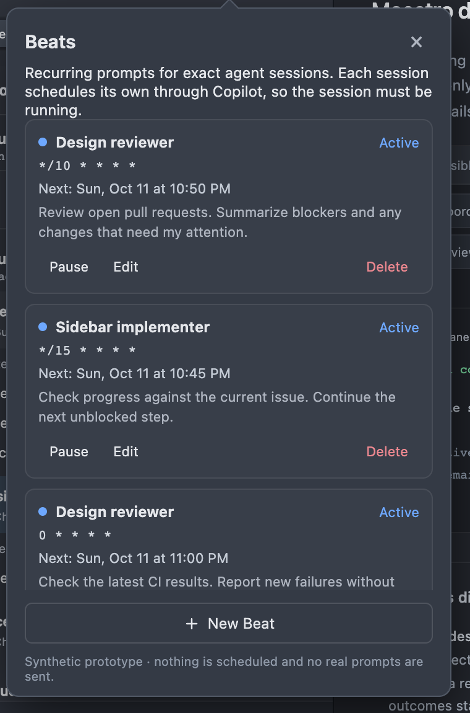

# CMUX Maestro

**See every Copilot agent. Trust none of the guesses.**

Maestro is a macOS sidebar for [CMUX](https://github.com/manaflow-ai/cmux). It shows your GitHub Copilot sessions, their sub-agents, and what each one needs from you. Many agents running. One column to watch.

<p align="center">
  
  &nbsp;
  
</p>
<sub>Synthetic data from the design prototype. No real sessions, paths, or work.</sub>

## Why

Run five agents and you lose track. Which one waits on a permission? Which one died? Which one is on the wrong branch? Maestro answers from evidence, not vibes.

- **Honest.** Unknown stays unknown. No guessing owners from titles. No "done" from a quiet terminal.
- **Safe.** Sidebar is sandboxed. Reads sanitized files. No transcripts, no credentials, no daemon.
- **Calm.** Passive previews. Finished work hides. Failures stay until you dismiss them.

## What you get

| Thing | What it does |
|---|---|
| **Hierarchy** | Workspaces, terminals, agents, nested workers, and their internal tasks. Git branch and worktree per agent. Drag or use the row menu to reorder; Maestro's order only, CMUX's is unchanged. |
| **Taskboard** | One card per agent, bucketed: Waiting on you, Working, Failed, Idle, Finished, Unknown. |
| **Attention** | Permission and question requests, errors, aborts. Separate cues. Acknowledge hides the notice only. |
| **Beats** | Recurring prompts for one exact session. Copilot's own scheduler runs them. |
| **Pets and icons** | Animated Codex pets. Per-session glyph and color. |
| **Peer messaging** | Same-workspace agents message each other with `/maestro`. Fire and forget. |
| **Active window footer** | Pinned details for the focused agent. Drag to resize. |

<p align="center">
  
</p>

## Install

Needs macOS 14+, Xcode 26.6 (to build), CMUX with sidebar extensions, and Copilot CLI 1.x.

```sh
./scripts/fetch-sdk.sh        # pinned CMUX ExtensionKit, once
./scripts/build-register.sh   # build, sign locally, install, set up Copilot
```

That installs `~/Applications/CMUX Maestro Preview.app` and the Copilot integration in one transaction. Then select **Maestro Sidebar** as the sidebar in CMUX.

- Running Copilot sessions are **not** restarted. Start new ones to load the hooks.
- Run **one** install at a time. Two at once strand the transaction.
- Interrupted? `python3 scripts/local-preview.py recover`.
- Update, rollback, uninstall: [install and recovery](docs/reference/install-update-recovery.md).

Optional peer messaging guide, installed by you, never by the app:

```sh
npx skills add jdylanmc/cmux-maestro --skill maestro --agent github-copilot --global --copy
```

## Use

1. Open the sidebar. Agents appear under their workspace.
2. Click a row to focus its terminal. Hover for a preview. Click the footer title for details.
3. Header buttons: open directory, Beats, Taskboard, settings.
4. Eye icon on a workspace reveals idle and finished internal tasks.
5. Click an agent's pet or icon to change it. `⇧⌘R` renames a workspace (CMUX does that, not us).

Agents launched by Maestro are normal interactive Copilot sessions. You can type to them. They never run headless.

Copilot sessions you start in CMUX after setup enroll as managed when they are eligible: they see their workspace peers and can spawn children. Sessions that were already running are left alone. A session can stay unmanaged (for example at capacity, or when an identity check fails); `maestro_readiness` gives the reason, and [ADR 0025](docs/adr/0025-copilot-sessions-started-in-cmux-are-born-managed.md) lists the limits.

After CMUX quits and reopens, sessions Maestro launched are designed to come back on their exact session once you approve Maestro's resume command prefix in **CMUX Settings > Terminal > Resume Commands**. Sessions you started come back only through CMUX's own Copilot restore, which needs CMUX's Copilot hooks and does not work for sessions started with `--name`. Wrapped launches (such as Agency) are not covered. This is not yet verified in a live CMUX; see [relaunch restore](docs/reference/relaunch-restore.md) for the gaps and the live checks.

## Rules of the house

- Unknown is a valid answer.
- Previews do nothing. Clicks do things.
- Maestro never kills, restarts, or types into your live sessions.
- Preview install is yours, not a release. No license yet.

Why each rule exists: [decisions](docs/adr/).

## Docs

| Read | For |
|---|---|
| [CONTEXT.md](CONTEXT.md) | Words we use, and words we avoid |
| [docs/adr/](docs/adr/) | Decisions, with reasons and rejected options |
| [docs/reference/](docs/reference/) | Full contracts: trust boundary, launch, lifecycle, history, install |
| [AGENTS.md](AGENTS.md) | Rules for AI agents and contributors |
| [docs/behavioral-parity.md](docs/behavioral-parity.md) | What is tested, what is not |
| [CHANGELOG.md](CHANGELOG.md) | What changed |

## Build and test

```sh
./scripts/fetch-sdk.sh
./scripts/build-unsigned.sh
./scripts/test.sh
```

`test.sh` runs everything, including offscreen render checks. A few UI-guide tests only pass on the GitHub-hosted runner. Details: [build and test](docs/reference/build-and-test.md).

## Status

Alpha. Local preview only. Public repo of [jdylanmc](https://github.com/jdylanmc). Independent of the older interpreted Maestro project. No license decided yet, so all rights reserved until one is chosen.
