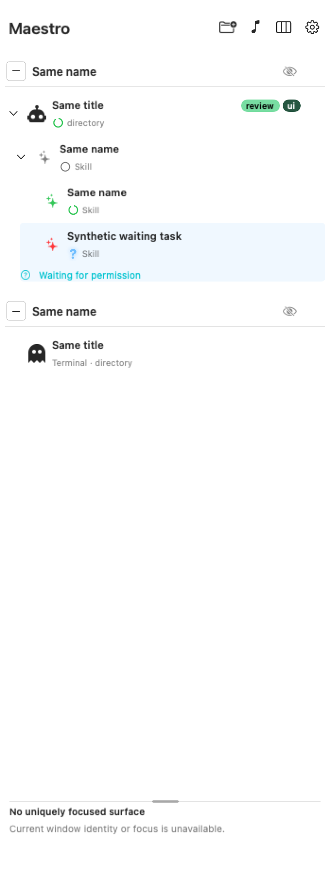

# Agent tags

Shared-color tags on agent rows (#51). Decision: [ADR 0026](../adr/0026-agent-tags-split-human-and-agent-assignment.md). Terms: [CONTEXT](../../CONTEXT.md).

## Canonical slug, version 1

Every entry point (sidebar editor, `tags` command, stored data) uses one rule:

1. Unicode NFKC.
2. Each character's default lowercase mapping, applied per character (no context rules such as final sigma).
3. NFKC again.
4. Each run of characters that are not letters (`L*`) or numbers (`N*`) becomes one `-`; leading and trailing `-` drop.

An empty result is refused ("needs a letter or number"). Limits: at most **24 Unicode scalars**
per slug and **6 tags per session per source** (human, agent). Over-limit input is refused whole;
nothing is truncated or dropped. `scripts/test-fixtures/tag-slug-cases.json` pins Swift and Python
to the same output.

## Assignment

- Assignments bind to the exact Copilot **session UUID**, never a title, pane or surface, so they
  follow the session across pane moves and restarts.
- **Human** tags: sidebar container, `sidebar-tags.json` (same preference coordinator as icons and
  order). Written only by the sidebar: **Edit tags…** in a row's actions, or **Edit tags…** in pinned
  details and the details popover.
- **Agent** tags: `~/Library/Application Support/CMUXMaestroPreview/Copilot/tags/agent-tags.json`
  (`{"version":1,"sessions":{"<lowercase uuid>":["slug",…]}}`, folder `0700`, file `0600`, at most
  2,048 sessions, 2 MiB; plain UTF-8 JSON with unique keys and integers only, checked identically by
  both sides against `scripts/test-fixtures/tag-store-cases.json`). Written only by the controller's `tags` command after the native identity
  helper proves the caller owns the session; writers lock `.lock` and replace atomically. The sidebar
  reads it through its existing read-only Copilot grant and never writes it. A read that fails keeps
  the last good tags.
- The same slug from both sources is one chip with both owners. Removing it from one source keeps
  the other.
- Retention: when a store is full, a new entry first drops sessions whose Copilot state folder is
  gone and colors for slugs no session carries; otherwise it is refused. **Reset all tags** in
  Settings clears your tags and colors.

```sh
"$MAESTRO" tags add|remove --self --session-id "$SESSION" --tag TAG [--tag TAG …]
"$MAESTRO" tags list|clear --self --session-id "$SESSION"
```

`remove` reports tags that were not assigned (`notAssigned`). There is no color option.

## Color

- **Automatic** (registry version 1): FNV-1a 32-bit over the slug's Unicode scalars;
  hue `hash % 360`, saturation `0.48 + ((hash >> 9) % 13) / 100`, lightness
  `0.64 + ((hash >> 17) % 9) / 100`, HSL to sRGB rounded per channel (the approved prototype's
  reference).
- **Human override**: one of 14 fixed swatches, stored per slug in `sidebar-tags.json`, so it applies
  to every occurrence on every session. **Use automatic color** removes it. Editor color changes,
  like tag text, are written only on **Save**; **Cancel** discards both. Agents cannot set colors.
  Colors are fixed sRGB values; light/dark appearance never changes them.
- Text is black or white, whichever contrasts more with the opaque chip background. Every automatic
  color (all 42,120 hue/saturation/lightness combinations) and every swatch is at least 4.5:1;
  tests check both the computed and the rendered pixels.

## Presentation



- Expanded agent rows (hierarchy, managed rows, Taskboard cards): compact chips inline with the title,
  right-aligned. The title keeps priority; chips that do not fit become `+N`, and the full set stays in
  details and in the row's tooltip and VoiceOver label.
- Pinned details, the details popover and hover cards list every tag with its owners
  (`You`, `Agent`, `You + agent`). A tag only the agent assigned has a dashed outline.
- The Beats panel lists the scoped session's tags.
- Collapsed branches show only their state summary, never chips. The sidebar has no collapsed
  worktree icon card yet; when one is added it shows no tags (September 29 RF-06).
- No filtering or grouping by tag.
