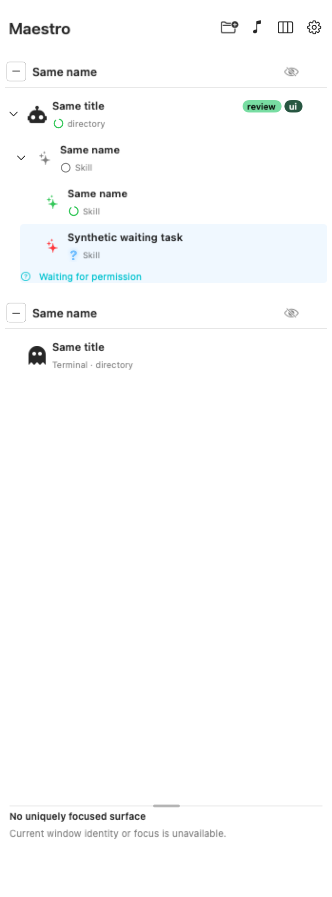

# Presentation

[↑ Agent tags](../agent-tags.md) | [← Color](color.md)

- Expanded agent rows (hierarchy, managed rows, Taskboard cards): compact chips inline with the title,
  right-aligned. The title keeps priority; chips that do not fit become `+N`, and the full set stays in
  details and in the row's tooltip and VoiceOver label.
- Pinned details, the details popover and hover cards list every tag with its owners
  (`You`, `Agent`, `You + agent`). A tag only the agent assigned has a dashed outline.
- The Beats panel lists the scoped session's tags.
- Collapsed branches show only their state summary, never chips. The sidebar has no collapsed
  worktree icon card yet. When one is added it shows no tags (September 29 RF-06).
- No filtering or grouping by tag.
